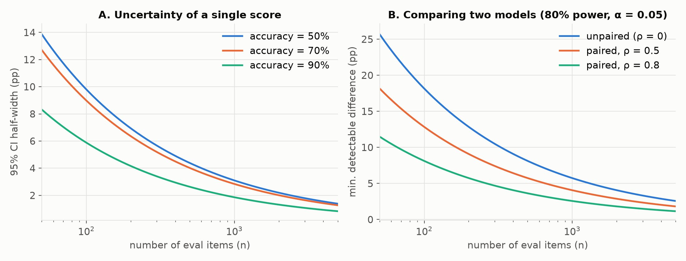
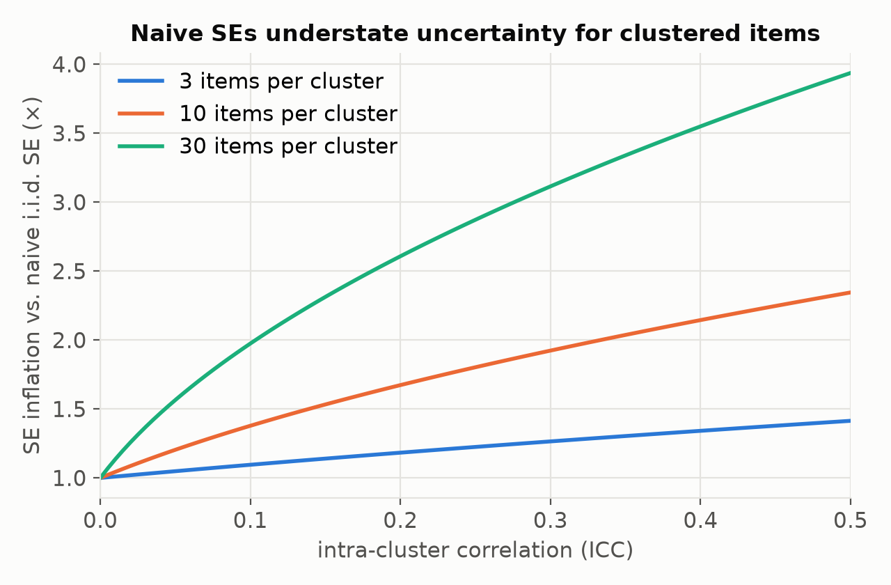
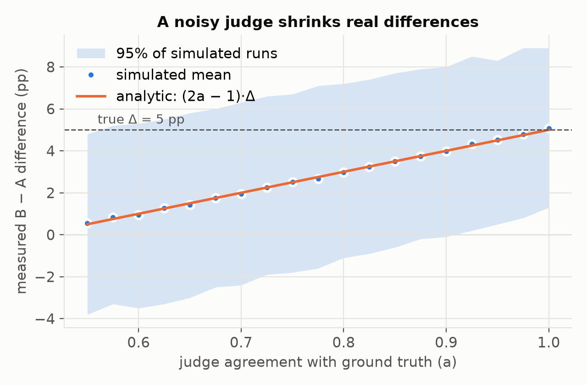

# Building an LLM Evaluation Framework: Architecture, Statistics, and Practice

<p class="byline">Evalframework Project · Technical report · September 2026</p>

<div class="abstract" markdown="1">

**Abstract.** Evaluation is the feedback signal for everything done with large language models (LLMs): choosing a model, changing a prompt, fine-tuning, shipping an agent. Yet most teams' evals are ad-hoc scripts whose scores carry no error bars, whose graders were never validated, and whose datasets may have leaked into training. This report is a design guide for building an LLM evaluation framework that produces numbers you can act on. We (1) synthesize the literature on benchmarks, model-graded evaluation, and evaluation methodology; (2) propose a modular reference architecture built around seven components: task specification, dataset, model adapter, runner, scorer, statistical aggregator, and reporting, with a content-addressed run record that makes every score reproducible; (3) give the statistical machinery a framework should build in, including confidence intervals, paired comparisons, clustered standard errors, and power analysis, and quantify with analytic results and seeded simulation how much each one matters; (4) treat LLM-as-a-judge as a measurement instrument that must be calibrated, and show that a judge with 80% agreement with ground truth shrinks a real 5-point difference to about 3 points and leaves it no longer reliably detectable at n = 1,000; and (5) cover operational concerns: contamination, agentic and retrieval-augmented tasks, regression gating in CI, and cost. We close with a checklist and a minimal task specification that teams can adopt directly.

</div>

## 1. Introduction

A model is only as good as the evidence that it is good. For classical supervised learning, that evidence was a held-out test set and a single metric. LLMs broke this arrangement in three ways. First, outputs are open-ended text, so "correct" often has no string-equality definition. Second, the same model is used for thousands of tasks, so no single benchmark describes it. Third, the systems being evaluated increasingly are not bare models but *pipelines*: a prompt, a retriever, tools, and multi-turn agent loops. Each component can change independently.

In response, the field produced large public benchmarks such as MMLU [1], BIG-bench [2], and HELM [3]; open harnesses such as EleutherAI's `lm-evaluation-harness` [4]; preference-based leaderboards such as Chatbot Arena [5]; and model-graded evaluation, where a strong LLM scores another's outputs [6, 7]. Those are the parts. Assembling them into an internal framework that answers "is version B better than version A, for *our* use case, and by how much?" is still largely folk knowledge.

This report aims to write that knowledge down. Our contributions are:

1. **A reference architecture** (Section 4) that separates *what* is evaluated (task and dataset) from *how* it is run (adapter and runner) and *how* it is judged (scorer and aggregator), and makes every result reproducible from a single run record.
2. **A statistical layer** (Section 6) that treats every score as an estimate with uncertainty. We show that 100 items give a ±9 percentage-point (pp) 95% confidence interval at 70% accuracy, and that paired analysis cuts the sample needed to detect a given difference roughly in half at moderate correlation.
3. **A calibration protocol for model-graded evaluation** (Section 7), grounded in a simple result: a symmetric-noise judge with agreement *a* attenuates true differences by a factor of (2*a* − 1).
4. **Operational guidance** (Sections 8–10) on contamination, agentic and RAG evaluation, and running evals as regression tests in CI.

All figures in this report are generated by `scripts/make_figures.py` from analytic formulas or seeded Monte Carlo simulation. We report no benchmark results for real models; the goal is methodology, not a leaderboard.

## 2. Background and Related Work

**Benchmarks.** Early LLM evaluation leaned on multiple-choice and short-answer benchmarks scored by exact match: MMLU covers 57 subjects [1]; BIG-bench collected over 200 tasks from the community [2]. HumanEval introduced functional correctness for code, scored by running unit tests and reported as pass@*k* with an unbiased estimator [8]. SWE-bench extended this to resolving real GitHub issues in full repositories [9]. IFEval showed that some qualities of free-form text can be checked programmatically ("answer in fewer than 100 words") [10].

**Holistic and multi-metric evaluation.** HELM argued that accuracy alone is insufficient and standardized a grid of scenarios × metrics, including calibration, robustness, fairness, bias, toxicity, and efficiency [3]. CheckList brought software-testing ideas to NLP: capability-by-test-type matrices with minimum-functionality, invariance, and directional tests [11].

**Reference-based metrics.** BLEU [12] and ROUGE [13] measure n-gram overlap; BERTScore [14] uses contextual embeddings. They are cheap and deterministic but correlate poorly with human judgments on open-ended generation [15].

**Model-graded evaluation.** Zheng et al. studied GPT-4 as a judge on MT-Bench and Chatbot Arena and found high agreement with humans, along with position, verbosity, and self-enhancement biases [6]. G-Eval used chain-of-thought rubrics and token probabilities for finer-grained scores [7]. Wang et al. showed that simply swapping answer order can flip judge verdicts [16]. Length-controlled AlpacaEval regresses out length to reduce verbosity bias [17]. Prometheus trained open judge models on rubric-conditioned feedback [18]. Shankar et al. observed that evaluation criteria themselves drift as people grade outputs, and argued for iterative alignment of judges with human preferences [19].

**Human preference at scale.** Chatbot Arena collects pairwise human votes and fits a Bradley–Terry model to rank models [5].

**Methodology and reproducibility.** Card et al. showed that many NLP comparisons are underpowered [20]; Dror et al. surveyed significance testing in NLP [21]. Biderman et al. documented how small implementation details (prompt format, answer extraction, normalization) move scores by several points, and argued for sharing full evaluation code and outputs [22]. Miller proposed treating evals as experiments, with standard errors, clustered errors for grouped questions, paired differences, and power analysis [23]. Data contamination, where test items appear in pretraining data, inflates scores and is hard to rule out [24, 25].

**Applications and agents.** RAGAS proposed reference-free metrics for retrieval-augmented generation (faithfulness, answer relevance, context relevance) [26]. τ-bench evaluates tool-using agents in simulated user conversations and introduced pass^<i>k</i> to measure consistency across repeated trials [27]. Kapoor et al. argued that agent evaluations must report cost alongside accuracy and guard against overfitting to the benchmark [28].

The literature supplies the ingredients. Our focus is how to combine them into one internal system.

## 3. Requirements

We derive seven requirements from the failure modes above.

| # | Requirement | Failure it prevents |
|---|---|---|
| R1 | **Reproducible:** every score is traceable to exact data, prompt, model, parameters, and scorer versions | "The number changed and nobody knows why" [22] |
| R2 | **Statistically honest:** every score carries an uncertainty estimate; comparisons are tests, not eyeballing | Shipping noise as improvement [20, 23] |
| R3 | **Composable:** new tasks, models, and scorers plug in without touching the core | One-off scripts that rot |
| R4 | **Grader-validated:** model-graded scorers are measured against human labels before they are trusted | Biased or noisy judges [6, 16] |
| R5 | **Sliceable:** results break down by task, category, difficulty, and metadata | Averages hiding regressions |
| R6 | **Pipeline-aware:** the unit under test can be a prompt, a RAG system, or an agent, not only a model | Evaluating the wrong thing |
| R7 | **Cheap to run often:** caching, concurrency, and sampling tiers make evals routine CI checks | Evals run once, before launch |

## 4. Reference Architecture

Figure 1 shows the architecture. Data flows left to right; every stage writes to a run record.

<figure>
<svg viewBox="0 0 960 330" xmlns="http://www.w3.org/2000/svg" font-family="DejaVu Sans, sans-serif" font-size="14" role="img" aria-label="Architecture diagram">
  <defs><marker id="ar" viewBox="0 0 10 10" refX="9" refY="5" markerWidth="7" markerHeight="7" orient="auto"><path d="M0,0 L10,5 L0,10 z" fill="#52514e"/></marker></defs>
  <g fill="#fff" stroke="#2a78d6" stroke-width="2">
    <rect x="10" y="40" width="150" height="70" rx="8"/><rect x="10" y="150" width="150" height="70" rx="8"/>
  </g>
  <g fill="#fff" stroke="#eb6834" stroke-width="2">
    <rect x="220" y="95" width="150" height="70" rx="8"/><rect x="410" y="95" width="150" height="70" rx="8"/>
  </g>
  <g fill="#fff" stroke="#1baf7a" stroke-width="2">
    <rect x="600" y="95" width="150" height="70" rx="8"/><rect x="790" y="40" width="160" height="70" rx="8"/><rect x="790" y="150" width="160" height="70" rx="8"/>
  </g>
  <g text-anchor="middle" fill="#0b0b0b" font-weight="bold">
    <text x="85" y="70">Task spec</text><text x="85" y="180">Dataset</text>
    <text x="295" y="125">Model adapter</text><text x="485" y="125">Runner</text>
    <text x="675" y="125">Scorer(s)</text><text x="870" y="70">Aggregator</text><text x="870" y="180">Reports &amp; gates</text>
  </g>
  <g text-anchor="middle" fill="#52514e" font-size="11">
    <text x="85" y="90">prompt, params, metrics</text><text x="85" y="200">versioned items + slices</text>
    <text x="295" y="145">model / RAG / agent</text><text x="485" y="145">concurrency, cache, retry</text>
    <text x="675" y="145">code · reference · judge</text><text x="870" y="90">CIs, paired tests</text><text x="870" y="200">dashboards, CI gates</text>
  </g>
  <g stroke="#52514e" stroke-width="1.6" fill="none" marker-end="url(#ar)">
    <path d="M160,75 L220,120"/><path d="M160,185 L220,140"/><path d="M370,130 L410,130"/><path d="M560,130 L600,130"/>
    <path d="M750,120 L790,80"/><path d="M870,110 L870,150"/>
  </g>
  <rect x="10" y="260" width="940" height="52" rx="8" fill="#f1f0ec" stroke="#c9c8c2"/>
  <text x="480" y="283" text-anchor="middle" fill="#0b0b0b" font-weight="bold">Run record (content-addressed)</text>
  <text x="480" y="302" text-anchor="middle" fill="#52514e" font-size="12">hash(task, dataset version, prompt template, model id + params, scorer version, seed) → raw outputs, scores, costs, latencies</text>
  <g stroke="#c9c8c2" stroke-dasharray="4 4"><path d="M85,220 V260"/><path d="M485,165 V260"/><path d="M675,165 V260"/><path d="M870,220 V260"/></g>
</svg>
<figcaption><b>Figure 1.</b> Reference architecture. Blue: <i>what</i> is evaluated. Orange: <i>how</i> it is executed. Green: <i>how</i> it is judged and reported. Every stage persists to a content-addressed run record (R1).</figcaption>
</figure>

### 4.1 Task specification

A task is a declarative document, not code. It names the dataset and version, the prompt template, the generation parameters, the scorers, and the aggregation. Declarative tasks can be diffed, reviewed, and hashed (R1), and new tasks require no framework changes (R3). Appendix A gives a minimal schema. The task spec should also say what the eval is *for*: the decision it informs and the smallest difference that would change that decision. That number drives sample-size planning (Section 6.4).

### 4.2 Dataset layer

Items are immutable and versioned; a change creates a new version. Each item carries an ID, input, optional reference(s), and **metadata for slicing** (R5): category, difficulty, source, language, and a *cluster ID* when items share a context (for example, several questions about one document), which the aggregator needs for correct standard errors (Section 6.3). Keep a datasheet for each dataset [29]: provenance, collection process, known gaps, and license.

Useful datasets usually mix three sources: (i) **production samples**, which represent real use but need labeling and PII scrubbing; (ii) **expert-written adversarial items** that target known weaknesses, in the spirit of CheckList [11] and Dynabench [30]; and (iii) **public benchmarks** for external comparability, which are treated as possibly contaminated (Section 8.1).

### 4.3 Model adapter

The adapter hides provider differences behind one interface: `generate(messages, params) → {text, tool_calls, tokens_in, tokens_out, latency, cost}`. Crucially, the thing behind the interface may be a whole **system**: a RAG pipeline or an agent loop (R6). The adapter records the resolved model identifier (not an alias like "latest"), so the run record pins what actually ran.

### 4.4 Runner

The runner fans out items × samples × systems with bounded concurrency, rate-limit-aware retries, and a **response cache** keyed by the hash of (model id, parameters, rendered prompt). The cache makes re-scoring free: changing a scorer need not re-query the model. Runs must be resumable, and failures (timeouts, refusals, malformed output) are recorded as outcomes, not silently dropped. Dropping failures biases scores upward.

### 4.5 Scorers

A scorer maps (item, output) to one or more scores plus an optional rationale. We distinguish four families, in rough order of preference:

1. **Programmatic checks:** exact match after normalization, regex, JSON-schema validation, unit tests [8, 9], and verifiable constraints [10]. Deterministic, cheap, and trustworthy, but only for tasks with checkable answers.
2. **Reference-based similarity:** BLEU, ROUGE, BERTScore [12–14]. Cheap, but weakly correlated with quality for open-ended outputs [15]; best used as a regression tripwire.
3. **Model-graded (LLM-as-judge):** a rubric-prompted LLM scores outputs pointwise or compares two pairwise [6, 7]. Flexible, but it is a *measurement instrument* that must be validated (Section 7).
4. **Human evaluation:** the ground truth for subjective quality, and the calibration target for (3). Expensive; use it sparingly and deliberately.

The design principle is **decompose, then check**: split a fuzzy quality ("is this a good answer?") into criteria that are individually checkable ("cites a source", "under 200 words", "states the refund policy correctly"), and use the cheapest reliable scorer for each.

### 4.6 Aggregator

The aggregator turns per-item scores into estimates *with uncertainty* (R2): means with standard errors, clustered where needed, per-slice breakdowns, and paired comparisons between systems (Section 6). For sampled outputs it computes pass@*k* with the unbiased estimator [8] and consistency metrics such as pass^<i>k</i> [27].

### 4.7 Reporting and gates

Reports show every headline number with its interval, the per-slice table, and links to raw outputs; reading transcripts is how you find what a metric misses. Gates encode decisions ("block merge if the paired difference on the safety slice is significantly negative") so that evals act as regression tests (Section 10).

### 4.8 The run record

Every run writes a record containing hashes of all inputs plus raw outputs, per-item scores, costs, and latencies. Two runs with the same hash are the same experiment. This one design choice delivers R1 and makes any past score auditable, which Biderman et al. identify as the main missing piece in published evaluations [22].

## 5. Choosing Metrics

**Match the metric to the decision.** Model selection needs comparable scores across candidates. Prompt iteration needs sensitivity to small changes. Release gating needs low false-alarm rates on critical slices. One eval rarely serves all three.

**Report a vector, not a scalar.** Following HELM [3], track quality alongside cost per item, latency (p50/p95), refusal rate, and format-validity rate. A 2-point accuracy gain that doubles cost is a different decision from a free one [28].

**Sampling-based metrics.** When outputs are sampled at temperature > 0, the score is a random variable per item. Draw *k* samples per item and report pass@*k* (at least one success) or pass^<i>k</i> (all succeed), depending on whether the application can retry. Averaging *k* samples per item also reduces within-item variance (Section 6.5).

**Beware metric gaming.** Once a metric becomes a target, systems learn its blind spots: verbosity for judges [6, 17], and format tricks for regex extractors. Keep a small hand-read audit sample in every report.

## 6. Statistical Layer

Every eval score is an estimate of performance on a population of possible inputs, computed from a finite sample. A framework that prints "73.4%" without an interval invites people to over-read noise [20, 23]. The formulas below are standard; the point is that the framework should compute them *by default*.

### 6.1 Confidence intervals for a single score

For *n* independent items with binary outcomes and observed accuracy *p̂*, the standard error is SE = √(*p̂*(1 − *p̂*)/*n*), and a 95% interval is *p̂* ± 1.96·SE. (For small *n* or *p̂* near 0 or 1, use the Wilson interval.) For non-binary scores, use the sample standard deviation, or a bootstrap over items [31].

Figure 2A plots the half-width. At 70% accuracy, **100 items give ±9.0 pp, 400 items ±4.5 pp, and 1,000 items ±2.8 pp.** Many internal evals have around 100 items; their scores cannot resolve differences smaller than about 10 points.


<p class="caption"><b>Figure 2.</b> (A) 95% CI half-width of a single accuracy score versus number of items. (B) Minimum difference detectable between two systems with 80% power at α = 0.05 (two-sided), baseline accuracy 70%, for unpaired analysis and paired analysis with per-item correlation ρ. Analytic.</p>

### 6.2 Paired comparisons

When comparing systems A and B on the **same** items, analyze the per-item differences *dᵢ* = *sᵢ*ᴮ − *sᵢ*ᴬ, not the two marginal scores. Because items vary in difficulty, the two systems' outcomes are positively correlated (ρ), and Var(*d*) = Var(*sᴬ*) + Var(*sᴮ*) − 2ρ·SD(*sᴬ*)·SD(*sᴮ*) shrinks as ρ grows [23]. For binary outcomes, McNemar's test is the exact paired alternative.

Figure 2B shows the effect. With 1,000 items at 70% accuracy, the minimum detectable difference falls from **5.7 pp unpaired to 4.1 pp at ρ = 0.5**. Equivalently, pairing at ρ = 0.5 halves the sample size needed for a given difference. It costs nothing to implement, so frameworks should make paired tests the default comparison.

### 6.3 Clustered standard errors

Items are often not independent: ten questions about one document, or five turns of one conversation. Treating them as independent overstates the effective sample size. With clusters of size *m* and intra-cluster correlation ICC, the variance inflates by the design effect 1 + (*m* − 1)·ICC [23]. Figure 3 shows that with 10 items per cluster and a modest ICC of 0.2, **the true SE is 1.67× the naive one**, so a naive 95% interval is really about a 76% interval. The fix is cheap: store a cluster ID on each item (Section 4.2) and compute cluster-robust SEs.


<p class="caption"><b>Figure 3.</b> Standard-error inflation from clustering, √(1 + (m − 1)·ICC). Analytic.</p>

### 6.4 Power analysis, before collecting data

Invert the formula: given the smallest difference δ that would change the decision (from the task spec, Section 4.1), the required number of items is approximately *n* ≈ (*z*₁₋α/₂ + *z*₁₋β)² · Var(*d*) / δ². Do this *before* building the dataset. If the result is 5,000 items and the budget allows 300, either accept that only large differences are detectable or redesign the eval, for example by increasing pairing correlation or reducing per-item noise.

### 6.5 Within-item variance and multiple testing

At temperature > 0, resampling the same item gives different outcomes. Averaging *k* samples per item reduces the within-item component of variance; the between-item component remains, so returns diminish quickly and *k* of 3–5 is usually enough [23]. When a report compares many slices or many candidate prompts, some will look significant by chance. Apply a correction (Holm or Benjamini–Hochberg), or pre-register the primary comparison and treat the rest as exploratory [21].

## 7. Model-Graded Evaluation as Measurement

An LLM judge is an instrument, and an uncalibrated instrument gives confident wrong readings. Known biases include:

- **Position bias:** preferring the first (or second) answer in pairwise comparisons [6, 16].
- **Verbosity bias:** preferring longer answers regardless of quality [6, 17].
- **Self-preference:** favoring outputs from the judge's own model family [6].
- **Rubric drift:** the criteria people actually care about change as they read outputs [19].

### 7.1 Noise attenuates effects

Beyond bias, a judge's plain *noise* has a consequence that is under-appreciated. Suppose the judge agrees with ground truth with probability *a* on each binary verdict, with symmetric errors. A system with true pass rate *p* then gets a measured rate of *a·p* + (1 − *a*)(1 − *p*), and the measured difference between two systems is **(2*a* − 1)·Δ**, where Δ is the true difference.

We verify this with a seeded simulation (2,000 replicate evals, 1,000 items each, true pass rates of 70% vs 75%; Figure 4). At *a* = 0.8, the mean measured difference is 2.97 pp instead of 5, and the central 95% of replicate results span −1.1 to 7.2 pp, which includes zero. The difference that a perfect grader detects reliably is **no longer reliably detectable** by an 80%-agreement judge at this sample size. Judge quality therefore trades off directly against sample size: halving (2*a* − 1) requires roughly four times as many items to recover the same power.


<p class="caption"><b>Figure 4.</b> Measured difference between two systems (true Δ = 5 pp) as a function of judge agreement <i>a</i>. Dots: mean of 2,000 simulated evals of 1,000 items each; band: 2.5–97.5th percentiles; line: analytic (2a − 1)·Δ. Seeded Monte Carlo.</p>

### 7.2 Calibration protocol

We recommend the following protocol before any judge is trusted with decisions:

1. **Build a gold set.** Have domain experts label 100–300 outputs from a *mix* of systems and quality levels, including hard, borderline cases. Record disagreements between annotators; inter-annotator agreement is the ceiling for any judge.
2. **Measure agreement.** Report accuracy and Cohen's κ (or Krippendorff's α) of judge vs gold, plus a confusion matrix. The confusion matrix shows whether errors are symmetric (attenuation) or one-sided (bias).
3. **Test for bias.** Swap the order of pairwise inputs and measure the flip rate. Regress judge scores on output length. Check for self-preference if the judge and a candidate share a model family.
4. **Mitigate.** Evaluate both orders and count only consistent verdicts, or average them [6, 16]. Use specific, binary or low-cardinality rubrics rather than 1–10 scales. Ask for reasoning before the verdict [7]. Control for length statistically [17]. Use a judge from a different family than the systems under test.
5. **Re-validate** when the judge model, its prompt, or the output distribution changes, and keep the gold set versioned with the dataset.
6. **Correct, if needed.** With measured agreement rates, measured scores can be de-biased (for example, divide differences by 2*a* − 1 under symmetric noise). Treat such corrections as approximate, and propagate the uncertainty in *a*.

## 8. Data Integrity

### 8.1 Contamination

If test items appeared in training data, scores measure memorization. For public benchmarks this cannot be ruled out [24]. Mitigations include: (i) **private held-out sets** that never leave the organization; (ii) **canary strings** embedded in datasets so leakage can be detected; (iii) **statistical tests** such as the exchangeability test of Oren et al., which detects when a model assigns higher likelihood to the canonical ordering of a benchmark than to shuffled orderings [25]; (iv) **freshness**, meaning items created after a model's training cutoff; and (v) **perturbation checks**, where rephrasing or changing numbers causes a large score drop.

### 8.2 Dataset hygiene

Deduplicate near-identical items, which otherwise act like clusters (Section 6.3). Audit reference answers: a few percent of labels in popular benchmarks are wrong, which caps achievable accuracy and adds noise. Keep a split between a *development* set used for prompt iteration and a *test* set reserved for decisions. Iterating against the test set overfits to it, just as in supervised learning [28].

## 9. Evaluating Pipelines: RAG and Agents

**Retrieval-augmented generation.** Score components separately as well as end to end [26]: retrieval (recall@*k* of gold passages, context precision), grounding (is each claim in the answer supported by the retrieved context? This is often checked with a claim-level judge, in the spirit of FActScore [32]), and answer quality. Component metrics localize failures that end-to-end scores only detect.

**Agents.** Agent runs are long, stochastic, and stateful. Framework support should include: (i) **sandboxed, resettable environments** so every trial starts from the same state [9, 27]; (ii) **outcome-based scoring** of the final environment state (tests pass, database row correct) rather than grading the trajectory's text; (iii) **repeated trials** reported as pass@*k* and pass^<i>k</i>, because a 60% success rate that is consistent is very different from one that is erratic [27]; (iv) **trajectory metrics** such as steps, tool errors, and tokens, and **cost per success** [28]; and (v) **simulated users** for conversational agents, whose own variability becomes part of the measurement variance.

## 10. Operationalizing Evals

**Tiers.** Keep a *smoke* tier (tens of items, seconds, on every commit), a *regression* tier (hundreds to low thousands, on every merge to main), and a *full* tier (everything, including human review, before release).

**Gates as statistical tests.** A gate like "score must not drop" fires on noise half the time. Instead, gate on a paired one-sided test ("fail if the lower confidence bound of B − A is below −δ"), per critical slice, with δ set from the task spec.

**Online evaluation.** Offline evals approximate production. Close the loop by sampling production traffic, scoring it with the same validated scorers, and feeding failures back into the dataset as new items. The dataset should grow from real failures.

**Cost control.** The response cache (Section 4.4) makes re-scoring free. Stratified sampling of large datasets keeps each tier cheap while preserving slice coverage. Batch APIs cut cost for non-urgent tiers.

**Read the transcripts.** Aggregate numbers tell you *whether* something changed; transcripts tell you *what*. Every report should surface a sample of outputs, especially discordant pairs where A passed and B failed.

## 11. Limitations

This report is methodological. The simulations assume independent items and symmetric judge errors; real judges have asymmetric, item-dependent errors, which cause bias as well as attenuation. The power formulas are large-sample approximations. We do not evaluate any real model or judge, and the recommended protocols should be validated in each team's own setting. Finally, no framework resolves the central difficulty of evaluation: deciding what "good" means for a task. The framework can only make that definition explicit, versioned, and measurable.

## 12. Conclusion

A useful evaluation framework is less about clever metrics than about discipline built into the tooling: declarative, versioned tasks; a run record that makes every number reproducible; scorers chosen from cheapest-reliable upward; judges treated as instruments and calibrated against humans; and a statistical layer that attaches uncertainty to every score and runs paired tests by default. The numbers in this report are simple but sobering. A 100-item eval cannot see differences smaller than about 10 points. Clustering can make a naive 95% interval behave like a 76% one. An 80%-agreement judge can hide a real 5-point improvement. Building these facts into the framework, rather than leaving them to each user, is what turns evaluation scripts into an evaluation *system*.

### Practitioner checklist

- [ ] Every task states the decision it informs and the minimum meaningful difference δ.
- [ ] Sample size was chosen by power analysis for δ.
- [ ] Items carry slice metadata and cluster IDs; datasets are versioned with a datasheet.
- [ ] Every score is reported with a 95% CI; comparisons are paired; clustered SEs are used where needed.
- [ ] Every model-graded scorer has a gold set, a reported κ, a position-swap test, and a length check.
- [ ] Failures, refusals, and timeouts count as outcomes.
- [ ] The run record hashes task, data, prompt, model id, parameters, scorer, and seed.
- [ ] A private held-out test set exists and is never used for iteration.
- [ ] CI gates are statistical tests on critical slices.
- [ ] Reports link to transcripts, including discordant pairs.

## Appendix A. Minimal task specification

```yaml
task: support_refund_policy
version: 3
purpose:
  decision: "Ship prompt v2 to production?"
  min_meaningful_diff_pp: 4        # δ, drives power analysis
dataset:
  name: support_tickets
  version: 2026-09-01
  cluster_key: ticket_thread_id     # for clustered SEs
  slices: [product_line, language, difficulty]
system:
  adapter: rag_pipeline
  model: provider/model-id-2026-08-15   # resolved id, never "latest"
  params: {temperature: 0.0, max_tokens: 800}
  prompt_template: prompts/refund_v2.jinja
samples_per_item: 1
scorers:
  - {type: json_schema, schema: schemas/reply.json}
  - {type: regex, name: cites_policy_id, pattern: "POL-\\d{4}"}
  - type: llm_judge
    rubric: rubrics/refund_correct.md   # binary: correct / incorrect
    judge_model: other-family/judge-2026-07
    pairwise_swap: true
    gold_set: gold/refund_v1.jsonl      # min kappa 0.7 to be trusted
aggregate:
  primary: llm_judge.correct
  ci: {method: cluster_bootstrap, level: 0.95, resamples: 2000}
  compare: {baseline: prompt_v1, test: paired, alpha: 0.05}
gate:
  fail_if: "lower_ci(test - baseline) < -2.0pp on slice=all or slice=language:es"
```

## Appendix B. Scoring loop (pseudocode)

```python
def run(task, systems):
    items = load_dataset(task.dataset)                        # immutable, versioned
    for sys in systems:
        for item in items:
            for k in range(task.samples_per_item):
                key = hash(sys.model_id, sys.params, render(task.prompt, item), k)
                out = cache.get(key) or cache.put(key, sys.generate(item))   # failures recorded
                scores[sys, item.id, k] = {s.name: s.score(item, out) for s in task.scorers}
    per_item = mean_over_k(scores)
    est  = {sys: cluster_mean_ci(per_item[sys], items.cluster_ids) for sys in systems}
    diff = paired_diff_ci(per_item[test], per_item[base], items.cluster_ids)
    record = RunRecord(hash_inputs(task, items, systems), scores, est, diff)
    return record, evaluate_gates(task.gate, diff, by_slice=items.slices)
```

## References

[1] D. Hendrycks, C. Burns, S. Basart, A. Zou, M. Mazeika, D. Song, J. Steinhardt. Measuring Massive Multitask Language Understanding. *ICLR*, 2021.

[2] A. Srivastava et al. Beyond the Imitation Game: Quantifying and Extrapolating the Capabilities of Language Models. *Transactions on Machine Learning Research*, 2023.

[3] P. Liang, R. Bommasani, T. Lee, et al. Holistic Evaluation of Language Models. *Transactions on Machine Learning Research*, 2023. arXiv:2211.09110.

[4] L. Gao, J. Tow, B. Abbasi, et al. A Framework for Few-Shot Language Model Evaluation (lm-evaluation-harness). Zenodo, 2021–2024.

[5] W.-L. Chiang, L. Zheng, Y. Sheng, et al. Chatbot Arena: An Open Platform for Evaluating LLMs by Human Preference. *ICML*, 2024.

[6] L. Zheng, W.-L. Chiang, Y. Sheng, et al. Judging LLM-as-a-Judge with MT-Bench and Chatbot Arena. *NeurIPS Datasets and Benchmarks*, 2023.

[7] Y. Liu, D. Iter, Y. Xu, S. Wang, R. Xu, C. Zhu. G-Eval: NLG Evaluation using GPT-4 with Better Human Alignment. *EMNLP*, 2023.

[8] M. Chen, J. Tworek, H. Jun, et al. Evaluating Large Language Models Trained on Code. arXiv:2107.03374, 2021.

[9] C. E. Jimenez, J. Yang, A. Wettig, S. Yao, K. Pei, O. Press, K. Narasimhan. SWE-bench: Can Language Models Resolve Real-World GitHub Issues? *ICLR*, 2024.

[10] J. Zhou, T. Lu, S. Mishra, et al. Instruction-Following Evaluation for Large Language Models. arXiv:2311.07911, 2023.

[11] M. T. Ribeiro, T. Wu, C. Guestrin, S. Singh. Beyond Accuracy: Behavioral Testing of NLP Models with CheckList. *ACL*, 2020.

[12] K. Papineni, S. Roukos, T. Ward, W.-J. Zhu. BLEU: a Method for Automatic Evaluation of Machine Translation. *ACL*, 2002.

[13] C.-Y. Lin. ROUGE: A Package for Automatic Evaluation of Summaries. *ACL Workshop on Text Summarization Branches Out*, 2004.

[14] T. Zhang, V. Kishore, F. Wu, K. Q. Weinberger, Y. Artzi. BERTScore: Evaluating Text Generation with BERT. *ICLR*, 2020.

[15] S. Gehrmann, E. Clark, T. Sellam. Repairing the Cracked Foundation: A Survey of Obstacles in Evaluation Practices for Generated Text. *Journal of Artificial Intelligence Research*, 2023.

[16] P. Wang, L. Li, L. Chen, et al. Large Language Models are not Fair Evaluators. arXiv:2305.17926, 2023.

[17] Y. Dubois, B. Galambosi, P. Liang, T. B. Hashimoto. Length-Controlled AlpacaEval: A Simple Way to Debias Automatic Evaluators. arXiv:2404.04475, 2024.

[18] S. Kim, J. Shin, Y. Cho, et al. Prometheus: Inducing Fine-grained Evaluation Capability in Language Models. *ICLR*, 2024.

[19] S. Shankar, J. D. Zamfirescu-Pereira, B. Hartmann, A. Parameswaran, I. Arawjo. Who Validates the Validators? Aligning LLM-Assisted Evaluation of LLM Outputs with Human Preferences. *UIST*, 2024.

[20] D. Card, P. Henderson, U. Khandelwal, R. Jia, K. Mahowald, D. Jurafsky. With Little Power Comes Great Responsibility. *EMNLP*, 2020.

[21] R. Dror, G. Baumer, S. Shlomov, R. Reichart. The Hitchhiker's Guide to Testing Statistical Significance in Natural Language Processing. *ACL*, 2018.

[22] S. Biderman, H. Schoelkopf, L. Sutawika, et al. Lessons from the Trenches on Reproducible Evaluation of Language Models. arXiv:2405.14782, 2024.

[23] E. Miller. Adding Error Bars to Evals: A Statistical Approach to Language Model Evaluations. arXiv:2411.00640, 2024.

[24] O. Sainz, J. A. Campos, I. García-Ferrero, J. Etxaniz, O. Lopez de Lacalle, E. Agirre. NLP Evaluation in Trouble: On the Need to Measure LLM Data Contamination for each Benchmark. *Findings of EMNLP*, 2023.

[25] Y. Oren, N. Meister, N. Chatterji, F. Ladhak, T. B. Hashimoto. Proving Test Set Contamination in Black-Box Language Models. *ICLR*, 2024.

[26] S. Es, J. James, L. Espinosa-Anke, S. Schockaert. RAGAS: Automated Evaluation of Retrieval Augmented Generation. *EACL System Demonstrations*, 2024.

[27] S. Yao, N. Shinn, P. Razavi, K. Narasimhan. τ-bench: A Benchmark for Tool-Agent-User Interaction in Real-World Domains. arXiv:2406.12045, 2024.

[28] S. Kapoor, B. Stroebl, Z. S. Siegel, N. Nadgir, A. Narayanan. AI Agents That Matter. arXiv:2407.01502, 2024.

[29] T. Gebru, J. Morgenstern, B. Vecchione, et al. Datasheets for Datasets. *Communications of the ACM*, 64(12), 2021.

[30] D. Kiela, M. Bartolo, Y. Nie, et al. Dynabench: Rethinking Benchmarking in NLP. *NAACL*, 2021.

[31] B. Efron, R. J. Tibshirani. *An Introduction to the Bootstrap*. Chapman & Hall, 1993.

[32] S. Min, K. Krishna, X. Lyu, et al. FActScore: Fine-grained Atomic Evaluation of Factual Precision in Long Form Text Generation. *EMNLP*, 2023.
